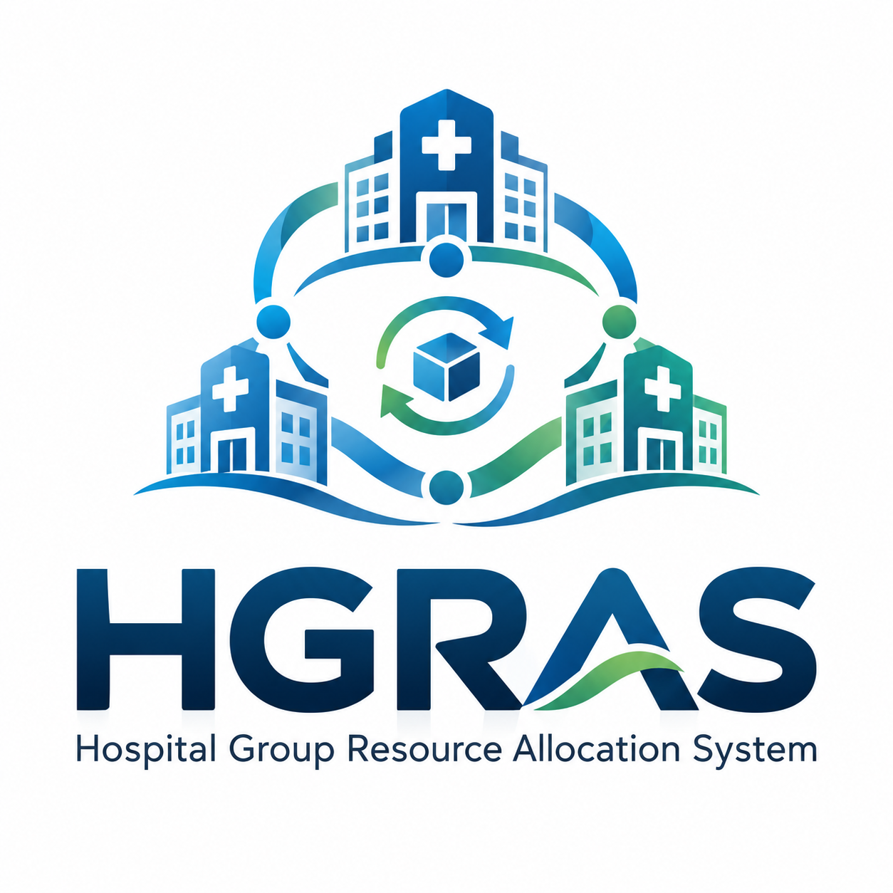

# HGRAS



### Hospital Group Resource Allocation System

HGRAS helps hospital groups coordinate resources across their facilities. Teams can view stock, protect minimum reserves, request transfers, approve allocations, record dispatch and reconcile deliveries through a shared workspace.

**The right resource. The right hospital. The right time.**

[User manual](docs/user-manual.md) · [Architecture](docs/architecture.md)

## Features

- Hospital groups, facilities, departments and responsible officers.
- Group and hospital-specific membership roles.
- Stock lots with units, batches, expiry dates and reserve thresholds.
- Resource search based on safely shareable quantities.
- Requests, approvals, reservations, dispatch and reconciled receipt.
- In-app transfer notifications and an audit trail.
- Equipment, staffing, capacity and procurement registers.
- Dashboard doughnut/bar charts and inventory CSV export.
- First-administrator registration and administrator-managed staff accounts.

## Technology

| Component | Technology |
| --- | --- |
| Application | C#, ASP.NET MVC 5, .NET Framework 4.7.2 |
| Interface | Razor, HTML, CSS, Bootstrap, JavaScript |
| Charts | Local SVG rendering; no external chart service |
| Identity | ASP.NET Identity and OWIN cookie authentication |
| Data | SQL Server, Entity Framework 6 and parameterised ADO.NET |
| Local hosting | IIS Express and SQL Server Express LocalDB |

## Requirements

Use Windows with:

1. Visual Studio 2022 or later, with the **ASP.NET and web development** workload.
2. The **.NET Framework 4.7.2 targeting pack** and **IIS Express**.
3. **SQL Server Express LocalDB**.
4. **PowerShell 7**, available as `pwsh`.

Internet access is needed for the first NuGet package restore. Node.js is not required to run HGRAS.

## Set up and run

Clone or download this repository to a short folder such as `C:\src\HGRAS` to avoid Windows path-length limits in older NuGet tooling. Open a PowerShell terminal in that folder and run:

```powershell
pwsh -File tools/Start-System.ps1
```

The launcher prepares local configuration, restores NuGet packages, creates or updates the local database, builds both applications and starts IIS Express. Existing application records are preserved. It creates no sample accounts or stock.

| Portal | Address |
| --- | --- |
| Staff administration and hospital network | http://localhost:9003 |
| Organisation portal and hospital network | http://localhost:9002 |

Default database: `(localdb)\MSSQLLocalDB` / `PGHResourceAllocation`.

### First-time administration

1. Open [staff registration](http://localhost:9003/Account/Register).
2. Register using your own email and password. The first account receives `ADMIN`; public staff registration then closes.
3. In the network workspace, choose **Create a hospital group**.
4. Add hospitals and departments under **Facilities**.
5. Create staff accounts through **System users**, then assign their network roles and hospitals under **Access**.
6. Record verified stock under **Inventory**.

There are no default login credentials. Organisation registration alone does not create a hospital group or network membership.

### Complete a transfer

1. A receiving hospital submits a request under **Transfers**.
2. The supplying hospital approves it. Approval reserves the quantity.
3. The supplying hospital records dispatch and transport details.
4. The receiving hospital records the usable quantity received and explains discrepancies.
5. Review **Inventory**, **Notifications** and **Audit**.

See the [user manual](docs/user-manual.md) for every screen, permission and workflow stage.

## Develop in Visual Studio

Open `ResourceAllocationService/ResourceAllocationService.sln`. It contains both applications.

Run the launcher once to prepare the database and private `Web.config` files. Then run either project through IIS Express in Visual Studio; its URLs may differ from ports 9002 and 9003.

To start the already-built applications:

```powershell
pwsh -File tools/Start-System.ps1 -SkipBuild
```

### Stop the applications

Use **Stop Debugging** for instances started by Visual Studio, or the IIS Express system-tray controls for instances started by the launcher. Stop only the sites belonging to this solution.

## Configuration and email

Setup copies `Web.config.example` to a private `Web.config` in each application. Keep real connection strings, SMTP credentials and generated machine keys out of Git.

Configure `SmtpHost`, `SmtpPort`, `SmtpUser`, `SmtpPass` and `SmtpFrom` in each portal's private configuration for confirmation emails and password recovery. Transfer notifications are stored in-app and do not depend on SMTP.

The scripts target local development. For hosted SQL Server, configure both Identity and Entity Framework connections, apply `database/` scripts in numerical order and configure IIS/HTTPS separately.

## Project layout

```text
ResourceAllocationAdmin/     Staff application
ResourceAllocationService/   Organisation application
Shared/                     Shared services, workflows, views and assets
database/                   Ordered, additive migrations
tools/                      Local setup and startup scripts
docs/                       User manual and architecture
```

The original project and database names remain unchanged to preserve existing references and local data.

## Troubleshooting

| Problem | Action |
| --- | --- |
| Missing packages or targeting pack | Restore NuGet packages and install the Visual Studio components listed above. |
| SQL error 50 / LocalDB unavailable | Check LocalDB installation and run the launcher as the Windows user who owns the instance. Inspect its `error.log`; do not delete the database to recover access. |
| Expired form token | Reopen the form and retry. Each portal has its own anti-forgery cookie. |
| No hospital workspace | Ask a group administrator to assign membership under **Access**. |
| Missing HGRAS tables | The workspace applies its additive migration. The database account needs permission to create missing schema objects. |
| Port 9002 or 9003 occupied | Stop the conflicting local application or use Visual Studio's configured IIS Express URLs. |
| Windows error `0x800711C7` | Application Control is blocking an assembly. Have the device administrator approve the application through its signing/allow-list process. |
| Email does not arrive | Verify SMTP configuration and provider authentication requirements. |

## Scope

HGRAS provides resource-sharing workflows and operational registers. Billing, forecasting, external hospital integrations, automated credential checks and patient-transfer authorisation are not implemented. LocalDB and IIS Express are development hosting, not a production deployment.

See [third-party notices](THIRD_PARTY_NOTICES.md) for bundled libraries and assets.
