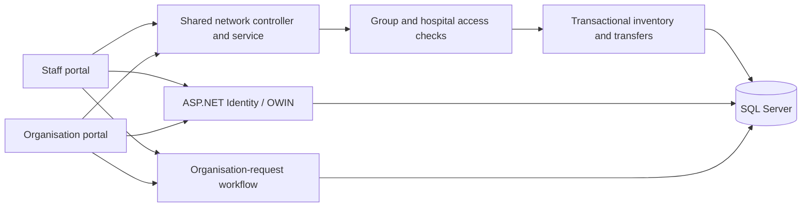

# HGRAS Architecture

## Applications

The solution contains two ASP.NET MVC 5 applications. `ResourceAllocationAdmin` provides staff administration and resource coordination; `ResourceAllocationService` provides organisation registration, organisation requests and the shared network workspace.

Both applications use SQL Server and compile shared service/workflow code. They have separate authentication and anti-forgery cookie names.

## Data boundaries

`Shared/HgrasNetwork.cs` checks membership, role and hospital assignment before mutations. Queries use parameters. Inventory search is group-wide; operational records and transfer history are restricted by hospital assignment.

Approval conditionally reserves safe stock in a serializable transaction. Dispatch deducts source inventory; receipt creates a destination lot for accepted units. Expected-stage/count checks prevent duplicate and stale updates. Audit entries and in-app notices commit with transfer changes.

The original organisation-request tables are separate from HGRAS network inventory. Network isolation does not convert all legacy administration routes into a complete multi-tenant SaaS.

## Database migrations

| Script | Purpose |
| --- | --- |
| `001-base-schema.sql` | Original Identity, organisation, resource and request schema. |
| `002-workflow.sql` | Organisation-request history, allocations and constraints. |
| `003-hgras-network.sql` | Groups, membership, hospitals, departments, lots, transfers, audit, registers and notices. |

`Initialize-System.ps1` prepares local development storage. `HgrasSchema` checks the packaged network migration when a workspace opens. Changes are additive and protected against concurrent initialisation.

## Presentation

Razor views use locally hosted CSS, JavaScript and images. Shared network views/assets have a packaged copy in each application; keep these copies in sync when changing `Shared/` presentation files.

Dashboard charts render SVG from server-generated counts. Labels are inserted as text. Numeric inputs are validated before rendering, and legends expose values independently of colour.

## Configuration and hosting

Actual `Web.config` files, credentials, machine keys, uploads and database files are excluded from Git. Sanitised examples support a fresh setup. SMTP is separate from in-app transfer notifications.

Production hosting requires IIS/SQL Server deployment, HTTPS, managed secrets, backups, monitoring and an environment-specific migration process. Subscription billing and external integrations are outside the current implementation.
